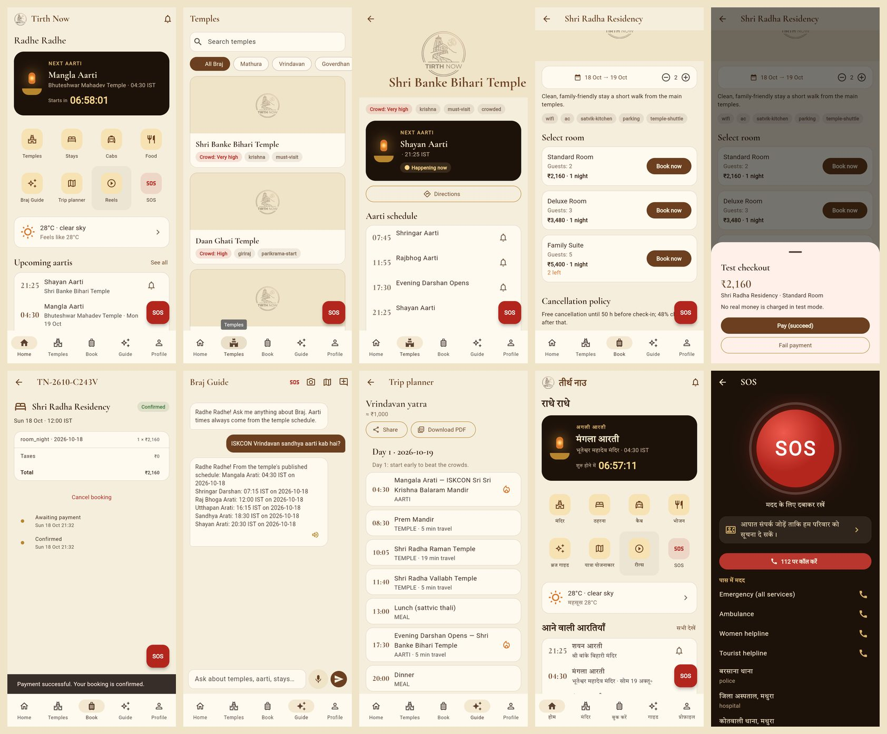

# Phase 3 — Mobile App: Completion Report

| | |
|---|---|
| **Status** | Complete (store builds wait on client accounts) |
| **Completed** | 18 October 2026 |
| **Branch** | `claude/peaceful-fermi-hvmzt4` |
| **App** | `apps/mobile` — Flutter 3.47 (Dart 3.13), Android, iOS, web preview |
| **Next** | Phase 4 — Vendor portal |

## 1. Summary

Phase 3 delivers the pilgrim app on top of the Phase 2 API. A traveller can sign in
with a phone OTP or as a guest, see the next aarti counting down, browse temples and
their schedules, set aarti reminders, book stays, cabs, food and experiences and pay
for them, raise an SOS that alerts family with a live-location link, read
notifications, watch reels, and ask the Braj guide by text or voice. Every screen
works in Hindi and English.

As in earlier phases, it runs with **zero external accounts**: sign-in and payment use
mock adapters (OTP `123456`, a test checkout), selected at build time. The real
Firebase and Razorpay adapters are in place for release builds.



### Verification at sign-off

Run on the final commit, against the Phase 2 API with all providers mocked
(PostgreSQL 16 + pgvector, Redis 7).

| Check | Command | Result |
|---|---|---|
| Format | `dart format --set-exit-if-changed lib test tool` | ✅ clean |
| Static analysis (strict casts, inference, raw types) | `flutter analyze` | ✅ no issues |
| Unit + widget tests | `flutter test` | ✅ 26 passed (contract tests skipped without an API) |
| Contract tests against the live API | `flutter test test/contract --dart-define=API_CONTRACT_URL=…` | ✅ 10 passed |
| Generated models current | `openapi:export --check`, `gen_api_models.mjs` | ✅ in sync |
| Web release build | `flutter build web --release` | ✅ built; walked through in Chromium (screens above) |
| API, after the small Phase 3 API changes | `pnpm lint`, `typecheck`, `test`, `test:e2e`, `format:check` | ✅ 326 unit, 123 e2e |
| Android debug build | `flutter build apk --debug` | ⏳ added to CI; not run here (Android SDK downloads are blocked in this environment) |

## 2. Scope delivered

| Area | What the app does |
|---|---|
| Sign-in | Phone OTP (Firebase or mock), guest mode, language choice; tokens in secure storage; one shared token refresh |
| Home | Greeting, next aarti with live countdown ("Happening now" once it starts), quick actions, weather with advisories, upcoming aartis, festivals |
| Temples | City filter, search, crowd level, temple detail with 3-day aarti schedule, directions, dress code, history, reviews |
| Reminders | Bell on any aarti; list and remove in notification settings |
| Stays | Date range and guests, hotel list, room availability and stay total, cancellation policy, reviews |
| Cabs | Pickup/drop between temples, fare quotes per vehicle class, booking |
| Food | Restaurants (pure veg, satvik), menu cart, pickup order |
| Experiences | Slots with remaining seats, seat count, booking |
| Payments | Order → checkout (Razorpay or test sheet) → server-side signature verification; pay later from the order |
| My bookings | Status, line items, taxes, refund amount, history, cancellation with refund preview, cab tracking link |
| SOS | 5-second hold, guest allowed, location (approximate fallback when GPS is off), share link, location updates every 30 s, cancel or "I am safe", call 112, nearby help |
| Emergency contacts | Add and remove; prompted from SOS when missing |
| Notifications | Inbox, mark read, preferences (aarti, bookings, default reminder time) |
| Reels | Vertical video feed, like, save, share, comments, saved reels |
| Braj guide | Streaming answers (SSE) with citations, suggestions, read aloud, ask by voice, identify a temple from a photo |
| Trip planner | Dates, days, pace, elders and wheelchair options; day-by-day plan with aarti items and travel time; share link; PDF |
| Weather & trains | 5-day forecast and advisories; train search with IRCTC links |
| Profile | Name, language (saved to profile), bookings, contacts, settings, sign out, delete account |

## 3. How it is built

- **Structure:** `lib/core` (API client, generated models, config, theme, router, cache)
  and `lib/features/<feature>/{data,presentation}`. Riverpod 3 without code generation;
  go_router with a five-tab shell; `/sos` is reachable while signed out (ADR-0017).
- **API models are generated, not hand-written.** The API exports its OpenAPI document
  (`pnpm --filter @tirth-now/api openapi:export`) and `tool/gen_api_models.mjs` turns its
  163 schemas into plain Dart classes. CI fails when either output is stale.
- **ApiClient** adds `/v1`, `Accept-Language`, the bearer token and `Idempotency-Key`
  (orders, payment verification, cancellation, SOS — one key per tap, so a retry never
  books twice). Concurrent 401s share a single refresh, because refresh tokens rotate
  and a second refresh would trip reuse detection (ADR-0002).
- **Offline:** temples, aarti, festivals, weather and the safety directory are cached
  (Hive) and shown when the network drops.
- **Aarti times** are shown exactly as the API returns them; the app never computes or
  estimates a time.
- **Language:** 173 strings in `app_en.arb` / `app_hi.arb`; Hindi uses the bundled Tiro
  Devanagari font, so it also renders offline and on web.
- **Brand:** cream, temple brown, gold and saffron, the same tokens as the website;
  Cormorant Garamond headings with lining figures so times read clearly.
- **Accessibility:** 48 dp touch targets, semantic labels on icon buttons and the SOS
  button, animations respect the system "reduce motion" setting.

## 4. Testing

| Suite | Count | Covers |
|---|---|---|
| `test/core/api_client_test.dart` | 4 | Headers and idempotency key; three concurrent 401s → exactly one refresh, then retry; rejected refresh clears the session; error mapping |
| `test/core/sse_test.dart` | 3 | Server-sent events split at arbitrary points, CRLF, non-JSON data |
| `test/core/formatters_test.dart` | 8 | Rupees from paise with Indian grouping, countdown, IST conversion, phone numbers |
| `test/features/identity_test.dart` | 3 | Mock identity tokens and OTP rejection |
| `test/features/widgets_test.dart` | 6 | Login validation and OTP step, Hindi rendering, live countdown, "Happening now", localised statuses |
| `test/features/guide_test.dart` | 2 | Guide streams an answer with its citation; typed question is sent |
| `test/contract/api_contract_test.dart` | 10 | Against the real API: catalog parsing, reminders, hotel order → test checkout → verified → cancelled with refund, idempotent replay, cab quotes, SOS, notifications, reels, AI chat stream quoting the schedule, planner |

CI gains three jobs: `mobile` (generated code check, format, analyze, tests),
`mobile-contract` (starts the API with mocks, runs the contract tests) and
`mobile-android` (debug APK build). The existing `checks` job now also verifies the
OpenAPI snapshot.

## 5. Running it locally

```bash
pnpm setup && pnpm dev                    # API on :4000 with mocks
cd apps/mobile && flutter pub get
flutter run                               # Android emulator
flutter run -d chrome --web-port 3001     # quick web preview
```

Sign in with any 10-digit mobile number and OTP `123456`. Full instructions:
`apps/mobile/README.md`.

## 6. API changes made in this phase

| Change | Why |
|---|---|
| `GET /v1/orders` documented as `OrderPageResponse` (`{ data, nextCursor }`) | It already returned a cursor page; the OpenAPI document said "array". Found by the contract tests. |
| `openapi:export` script + `buildOpenApiDocument()` | Exports the OpenAPI document without a database, for the model generator and CI. |

## 7. Decisions recorded

- **ADR-0017** — Mobile app structure: generated models from OpenAPI instead of
  freezed/build_runner, Riverpod + go_router, client-side mock/real adapters for
  identity and payments, offline cache, and the cream/brown/gold brand replacing the
  Phase 0 green/black tokens.

## 8. Known limitations and deferred items

- **No store builds yet.** Android and iOS were not compiled here (Android SDK downloads
  are blocked in this environment); the Android debug build runs in CI. iOS needs a Mac
  and the Apple account (Codemagic, Phase 6).
- **Push notifications** are not wired on the device yet: they need the Firebase project
  (FCM token registration exists in the API). The in-app inbox works.
- **Maps:** cab pickup and drop are chosen from temples, not a map; directions and cab
  tracking open Google Maps. An in-app map needs the Maps SDK key.
- **Realtime:** order and cab updates refresh on pull-to-refresh rather than over the
  Socket.IO channel.
- **Reel upload** is not in the app yet (feed, likes, saves and comments are).
- **Voice** recording on web previews depends on the browser; on devices it uses the
  microphone permission.

## 9. Actions needed from the product owner

New rows 20–22 in `docs/CLIENT_SETUP_TODO.md`: final app id, icons and store listing;
Firebase files and the Razorpay key id for release builds; production API origin.
Items 1–4 (Firebase, Apple, Google Play, Razorpay) are now on the critical path for
the first store build.

## 10. Next: Phase 4

Vendor portal (Next.js): onboarding and KYC, listings and inventory calendars, order
inbox with accept/reject, payouts and statements, review replies — using the same
OpenAPI document via `packages/api-client`.
